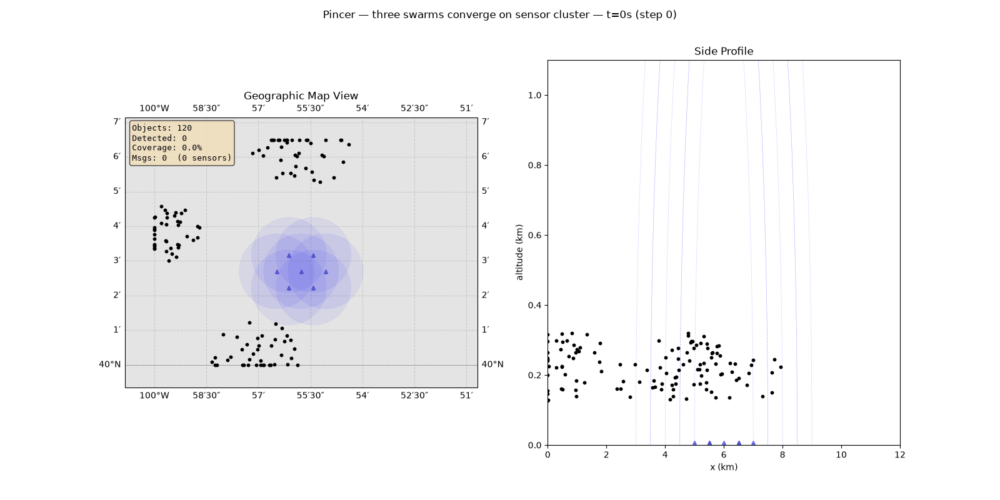

# swarmsim

[](https://github.com/rsivilli/swarmsim/actions/workflows/ci.yml)

**Sensor coverage modeling → communication timeline generation → load testing.**

swarmsim (CLI: `modsim`) simulates configurable swarms of objects moving through a sensor field, computes detection events per timestep, and exports the resulting communication traffic as a timeline that [Locust](https://locust.io/) replays against your backend. Use it to answer "how much traffic will my sensor-fusion backend see if N drones fly through M sensors?" before you build or deploy.



## Installation

Requires Python 3.11+ and [uv](https://docs.astral.sh/uv/).

```bash
git clone https://github.com/rsivilli/swarmsim.git
cd swarmsim
uv sync

# Optional extras
uv sync --extra loadtest   # Locust, Zenoh, and the Zenoh monitor
uv sync --extra udl        # Unified Data Library (UDL) transport for Locust
uv sync --extra rf         # pyarrow + sigmf for RF truth tables and SigMF validation (modsim rf)
```

## Quickstart

```bash
# Run a scenario and print a detection summary
uv run modsim run scenarios/minimal_test.yaml --no-viz

# Interactive plot / animated playback
uv run modsim run scenarios/pincer.yaml
uv run modsim run scenarios/pincer.yaml --animate

# Save an animation (.gif, .mp4, .mov, .html), drawing every 2nd timestep
uv run modsim run scenarios/pincer.yaml --map-style basic --frame-step 2 --save-animation pincer.gif
```

Map styles other than `basic` download map tiles, so they need network access.

## End-to-End Workflow

### 1. Run simulation and export comms timeline

```bash
# Install dependencies
uv sync

# Run a scenario and generate the comms timeline + Helm values in one step
uv run modsim run scenarios/mothership_salvo.yaml \
  --no-viz --export-mode comms --helm-values

# Output:
#   output/mothership_salvo_comms.json   ← Locust timeline
#   output/mothership_salvo_comms_values.yaml  ← Helm deployment values
```

The comms export contains every sensor detection event as a timestamped message (Track.json format) with sender/receiver routing, ready for Locust to replay.

To visualize the scenario first:

```bash
# Static 3-panel plot
uv run modsim run scenarios/mothership_salvo.yaml --map-style satellite

# Animated playback
uv run modsim run scenarios/mothership_salvo.yaml --map-style satellite --animate
```

### 2. Run Locust locally

```bash
cd locust

# Build the Locust container
docker build -t modsim-locust:latest .

# Run against a local backend
docker run -p 8089:8089 \
  -v $(pwd)/../output/mothership_salvo_comms.json:/timeline.json \
  -e BACKEND_HOST=http://host.docker.internal:8080 \
  modsim-locust:latest \
  locust -f /locust/locustfile.py --host=http://host.docker.internal:8080

# Open http://localhost:8089
```

### 3. Deploy Locust to Kubernetes

```bash
# Create ConfigMap with the timeline
kubectl create configmap locust-timeline \
  --from-file=timeline.json=output/mothership_salvo_comms.json

# Deploy using the auto-generated Helm values
helm install modsim-loadtest ./locust/helm-chart \
  -f output/mothership_salvo_comms_values.yaml \
  --set backend.host=http://my-backend-svc.default.svc:8080

# Access the Locust UI
kubectl port-forward svc/modsim-loadtest-modsim-locust-master 8089:8089
# Open http://localhost:8089
```

The generated Helm values include recommended worker counts, user counts, spawn rate, and run time derived from the simulation's message rate and duration.

## Transport Modes

Locust supports three transport backends, selected via the `ZENOH_TRANSPORT` env var:

| Mode | Env value | Description |
|------|-----------|-------------|
| REST HTTP | `rest` (default) | POST to `/api/tracks` or PUT to Zenoh REST bridge |
| Native Zenoh | `native` | Direct publish via eclipse-zenoh SDK to a Zenoh router |
| UDL SDK | `udl` | Publish tracks to UDL via `udl-sdk` |

```bash
# Native Zenoh example
docker run -p 8089:8089 \
  -v $(pwd)/output/mothership_salvo_comms.json:/timeline.json \
  -e ZENOH_TRANSPORT=native \
  -e ZENOH_ROUTER=tcp/zenoh-router:7447 \
  modsim-locust:latest locust -f /locust/locustfile.py

# UDL example
docker run -p 8089:8089 \
  -v $(pwd)/output/mothership_salvo_comms.json:/timeline.json \
  -e ZENOH_TRANSPORT=udl \
  -e UDL_AUTH_USERNAME=user \
  -e UDL_AUTH_PASSWORD=pass \
  -e UDL_BASE_URL=https://your-udl-instance.example/ \
  -e UDL_CLASSIFICATION=<marking> \
  modsim-locust:latest locust -f /locust/locustfile.py
```

The UDL transport requires `UDL_BASE_URL` and `UDL_CLASSIFICATION` to be set explicitly; there is no default endpoint. In Helm, set `transport.mode=udl`, `udl.baseUrl` and `udl.classification`, and create the `udl-credentials` Secret.

## CLI Reference

```bash
modsim run <scenario.yaml> [OPTIONS]
  --no-viz              Skip visualization
  --animate             Animated playback instead of static plot
  --save-animation PATH Save animation to file (.gif, .mp4, .mov, .html)
  --frame-step N        Animate every Nth timestep (faster saves for long runs)
  --map-style STYLE     terrain|satellite|street|toner|basic (default: terrain)
  --export PATH         Export results to JSON (default: output/{scenario}_{mode}.json)
  --export-mode MODE    default|comms|states|both
  --helm-values         Generate Helm values YAML (requires --export-mode comms)
  --verbose, -v         Detailed progress with timing

modsim validate <scenario.yaml> [--strict]
  # Check YAML syntax and configuration without running

modsim rf <scenario.yaml> [--dry-run] [--out DIR] [--window START:END] [--sensors ID,...]
                  [--workers N] [--force] [--truth-format auto|parquet|csv]
  # RF emission schedule, link budgets, truth tables, IQ sizing and SigMF IQ synthesis

modsim helm-values <comms_export.json> [-o output.yaml]
  # Generate Helm values from an existing comms export

modsim animate-all [scenario_dir] [-o output/animations] [--format mp4|gif|mov|html] [--frame-step N]
  # Render an animation for every scenario in a directory

modsim version
```

## Scenario Configuration

Scenarios are YAML files. Spatial units are **km**, speeds **km/s**, time **seconds**.

```yaml
name: "My scenario"

area:
  width_km: 10.0
  height_km: 10.0

dt: 1.0           # timestep in seconds
duration: 300      # total simulation time
seed: 42           # optional, for reproducibility

# Geographic reference point for map projection (optional)
reference_origin:
  - 37.7749         # latitude
  - -122.4194       # longitude

detection:
  mode: binary             # "binary" or "probabilistic"
  range: 2.0

groups:
  - group_id: alpha
    count: 20
    mode: swarm             # "swarm" or "formation"
    heading: [1.0, -0.3]
    speed_min: 0.04
    speed_max: 0.07
    spawn_center: [0.5, 7.0]
    spawn_radius: 1.0
    spacing_profile: gaussian  # "uniform", "gaussian", or "random"
    spawn_altitude: 0.0
    spawn_altitude_range: 0.0

sensors:
  layout: grid              # "manual", "grid", "hex", or "random"
  detection_range: 1.5
  spacing: 2.5

# Communication emulation (required for comms export)
communication:
  enabled: true
  strategy:
    name: direct
    protocol: zenoh_pubsub  # "zenoh_pubsub" or "rest_post"
  topology:
    bundling_mode: none     # "none", "relay", or "time_window"
  sensor_metadata:
    - sensor_idx: 0
      sensor_id: "RADAR-01"
      asset: "SENSOR-PLATFORM-1"
      asset_nat: "US"
      sen_type: "RADAR"
```

### Object Groups

| Field | Description |
|-------|-------------|
| `mode: swarm` | Each object gets slight heading perturbation and individual speed |
| `mode: formation` | All objects share exact velocity (rigid body translation) |
| `spacing_profile: uniform` | Fibonacci spiral distribution within spawn radius |
| `spacing_profile: gaussian` | Clustered around spawn center (3-sigma = spawn_radius) |
| `spacing_profile: random` | Uniformly random within spawn radius |

### Sensor Layouts

| Layout | Required fields | Description |
|--------|----------------|-------------|
| `manual` | `positions` | Explicit (x, y) or (x, y, z) coordinates |
| `grid` | `spacing` | Regular rectangular grid |
| `hex` | `spacing` | Hexagonal/staggered grid |
| `random` | `count` | Uniformly random placement |

### Detection Modes

**Binary**: detected if within sensor range.

**Probabilistic**: Pd decreases with distance.
- `exponential`: Pd = exp(-k * d)
- `sigmoid`: Pd = 1/(1 + exp(k * (d - half_range)))

## RF Emitters and SigMF (preview)

swarmsim is gaining an RF layer: drones, their ground controllers and background devices act as RF
emitters with commercial link profiles, and RF sensors record SigMF IQ. See
[docs/design/rf-sigmf.md](docs/design/rf-sigmf.md) for the full design. **Phases 0–2** are
available now:

- Every emission is scheduled, and each sensor gets a link budget (free-space loss, radio horizon,
  SNR, detectability, Doppler, bearing).
- Ground-truth tables and IQ storage estimates are written for every run.
- Single-element sensors with `fixed` or `multi` tuning get synthesized IQ as SigMF recordings, with
  per-emission annotations.
- All built-in links use protocol-like waveforms:
  - ExpressLRS/Crossfire: LoRa chirps.
  - Analog FPV: FM video.
  - DJI OcuSync and DroneID: LTE-like OFDM with Zadoff-Chu sync.
  - Wi-Fi and Remote ID over Wi-Fi: 802.11 OFDM with the legacy preamble.
  - BLE, Remote ID over BLE and SiK: GFSK.

  Arrays and scanning sensors arrive in Phases 3–4.

```bash
uv sync --extra rf    # optional: pyarrow (Parquet truth) and sigmf-python
uv run modsim rf scenarios/rf_fpv_mix.yaml --dry-run                          # truth + sizing only
uv run modsim rf scenarios/rf_fpv_mix.yaml --window 0:2 --sensors RF-01,RF-04 # synthesize IQ
# output/rf/rf_fpv_mix/
#   manifest.json        sizing, counts, seeds, timings, synthesis results
#   truth/emitters.*     every drone, controller and background emitter
#   truth/emissions.*    every burst / hop / continuous transmission (time, frequency, EIRP, position)
#   truth/links.*        per (emission, sensor, band): range, bearing, Doppler, SNR, detectable
#   RF-01/RF-01_ism915.sigmf-{data,meta}   IQ + annotations (signal:detail, signal:emitter, truth)
#   RF-01/RF-01.sigmf-collection
```

IQ is large: a single 100 MS/s ci16 channel writes 400 MB/s. The CLI checks the estimate against
free disk space (override with `--force`). Use `--window` and `--sensors` to synthesize a subset,
and `--workers N` to parallelize. Output is byte-identical for any worker count.

Built-in link profiles live in `modsim/rf/profiles/` (DJI OcuSync downlink/uplink and DroneID,
ExpressLRS 900 MHz / 2.4 GHz, Crossfire, analog FPV, Wi-Fi drones, Remote ID over BLE and Wi-Fi, an
intermittent SiK telemetry radio, `silent`, plus background Wi-Fi APs and BLE devices). Their
parameters come from public sources and are provisional. Attach them to groups and declare RF sensors
in the scenario:

```yaml
groups:
  - group_id: fpv
    # ... motion fields ...
    rf:
      links:
        - profile: elrs_900
        - {profile: analog_fpv, params: {channel: R5}}
      controller:
        placement: per_group          # per_drone | per_group | {count: N} operator sites
        offset_from_spawn: [-0.8, -0.5]
        links: [elrs_900]

rf:
  epoch: "2026-01-01T00:00:00Z"
  background:
    - {profile: wifi_ap, density_per_km2: 1.0}

rf_sensors:
  - id: RF-01
    position: [4.0, 4.0, 0.010]       # km
    type: detect                      # detect | df (df needs an array)
    receiver: {noise_figure_db: 6, sample_format: ci16_le}
    tuning:
      mode: fixed                     # fixed | multi | scanning
      bands:
        - {name: ism915, center_hz: 915.0e6, sample_rate: 30.0e6}
```

## Example Scenarios

### Real-World Inspired

| Scenario | Objects | Sensors | Based On |
|----------|---------|---------|----------|
| `mothership_salvo.yaml` | 450 | 10 | China's Jiu Tian drone mothership — 3 HALE carriers releasing 150 loitering munitions |
| `eu_drone_wall.yaml` | 500 | 30 | EU's planned 4,000km drone detection wall — 100km border segment |
| `hellscape_strait.yaml` | 10,000 | 18 | INDOPACOM "Hellscape" concept — 10,000 attritable UAS across a 130km strait |
| `ddp_50k.yaml` | 50,000 | 17 | DoD Drone Dominance Program — 50,000 drones across a 200km x 80km theater |
| `shahed_wave.yaml` | 750 | 12 | Russia's record single-night Shahed wave (750 drones) |

### Scaling Reference

Benchmarked on Apple Silicon. Scaling is roughly linear in `objects * sensors * steps`.

| Objects | Sensors | Steps | Wall Time |
|---------|---------|-------|-----------|
| 1,000 | 50 | 300 | ~0.8s |
| 10,000 | 100 | 300 | ~17s |
| 50,000 | 100 | 100 | ~32s |

## Comms Export Format

The `--export-mode comms` output is a JSON file with this structure:

```json
{
  "metadata": {
    "scenario": "...",
    "total_events": 12000,
    "duration_sec": 1200.0,
    "total_messages": 12000
  },
  "config": {
    "communication": { "strategy": {...}, "topology": {...} },
    "reference_origin": [28.0, 125.0],
    "recommended_deployment": {
      "users": 30, "spawn_rate": 5, "run_time": "20m",
      "worker_replicas": 3
    }
  },
  "events": [
    {
      "time": 0.11,
      "sender": "RADAR-01",
      "receiver": "backend",
      "transport": "zenoh_pubsub",
      "payload": { "trkId": "...", "lat": 28.01, "lon": 125.03, ... },
      "bundle_size": 1
    }
  ]
}
```

For large simulations (>50k objects), use the JSONL streaming format by specifying a `.jsonl` extension on the export path. The Locust replay script auto-detects the format and streams events lazily with O(batch) memory per worker.

## Architecture

```
modsim/
  cli.py          Click CLI (run, validate, export, helm-values, version)
  config.py       YAML loading + validation
  models.py       Dataclasses, enums, Vec2/Vec3
  motion.py       Object spawning + per-timestep motion
  detection.py    NumPy-accelerated pairwise distance, binary + probabilistic Pd
  sim.py          Simulation loop
  report.py       Console summary + JSON export
  viz.py          Static matplotlib plot + FuncAnimation
  comm/
    track_manager.py    Track ID management and state machine
    track_messages.py   Track.json message generation
    export.py           Locust timeline generation (JSON + JSONL)
    helm_values.py      Helm values YAML generation
  rf/
    profiles/           Commercial link profile library (YAML)
    config.py           rf / rf_sensors / groups[].rf parsing and validation
    scheduler.py        Emitters (drones, controllers, background) and emission scheduling
    links.py            Per-sensor link budget, detectability, scanning coverage
    runner.py           modsim rf pipeline, truth tables and manifest
    waveforms/          LoRa, FM video, OFDM (Wi-Fi/LTE/DroneID), GFSK, CW, native-rate resampling
    synth.py            Chunk renderer (delay, Doppler, path loss, anti-alias)
    receiver.py         Thermal noise, full scale, ADC quantization and clipping
    iq.py               Recording jobs, multiprocess synthesis
    sigmf_writer.py     .sigmf-meta annotations and .sigmf-collection

locust/
  locustfile.py         Timeline replay with REST, Zenoh native, and UDL transports
  zenoh-monitor.py      Live dashboard of detections arriving on a Zenoh router
  Dockerfile            Container image
  helm-chart/           Kubernetes deployment manifests

k8s/zenoh.yaml          Zenoh router deployment for local clusters
```

Simulation loop order per timestep: **detect → record stats → step motion → remove out-of-bounds → repeat**.

## Development

```bash
# Run tests
uv run pytest tests/ -v

# Lint and format
uv run ruff check .
uv run ruff format .

# Validate all scenarios
for f in scenarios/*.yaml; do uv run modsim validate "$f"; done
```

CI runs lint and the test suite on Python 3.11 and 3.14, and validates every bundled scenario.

## License

[MIT](LICENSE)
